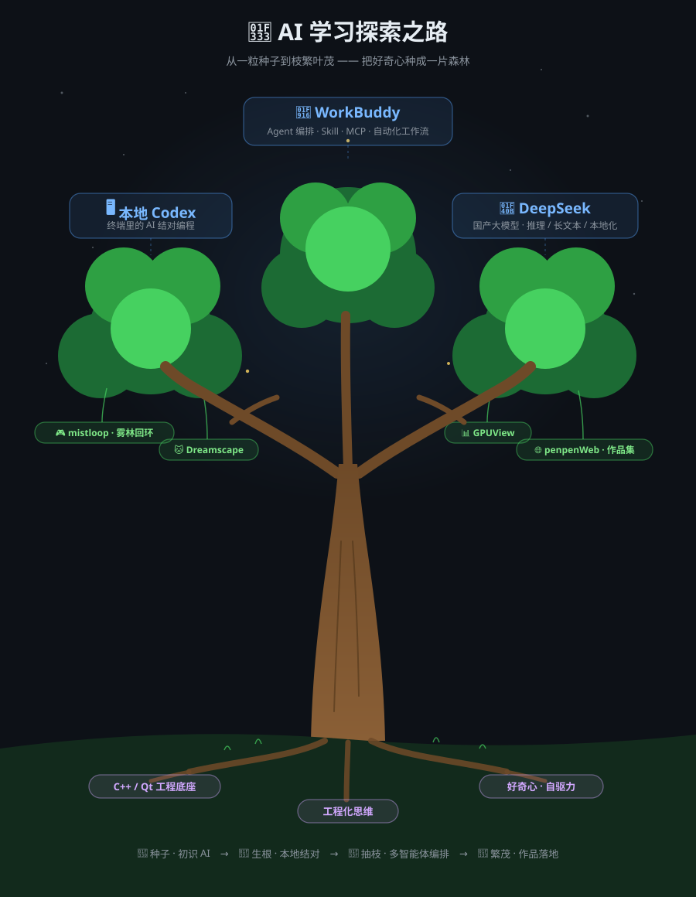

<div align="center">

<picture>
  <source media="(prefers-color-scheme: dark)" srcset="https://readme-typing-svg.demolab.com?font=Fira+Code&size=26&duration=3000&pause=800&center=true&vCenter=true&width=760&color=70A5FD&lines=Hi%2C+I%27m+penpen+%28%E7%8E%8B%E5%B8%85%E9%B9%8F%29+%F0%9F%91%8B+C%2B%2B+%2F+Qt+%E6%A1%8C%E9%9D%A2%E5%BC%80%E5%8F%91+%C2%B7+%E6%B8%B8%E6%88%8F%E5%BC%80%E5%8F%91+Godot+%2B+Blender+%C2%B7+Three.js+%C2%B7+Next.js+%E7%94%A8%E4%BB%A3%E7%A0%81%E6%9E%84%E5%BB%BA%E6%9C%89%E8%B6%A3%E7%9A%84%E4%B8%9C%E8%A5%BF+%C2%B7+Coding+with+curiosity">
  <source media="(prefers-color-scheme: light)" srcset="https://readme-typing-svg.demolab.com?font=Fira+Code&size=26&duration=3000&pause=800&center=true&vCenter=true&width=760&color=0969DA&lines=Hi%2C+I%27m+penpen+%28%E7%8E%8B%E5%B8%85%E9%B9%8F%29+%F0%9F%91%8B+C%2B%2B+%2F+Qt+%E6%A1%8C%E9%9D%A2%E5%BC%80%E5%8F%91+%C2%B7+%E6%B8%B8%E6%88%8F%E5%BC%80%E5%8F%91+Godot+%2B+Blender+%C2%B7+Three.js+%C2%B7+Next.js+%E7%94%A8%E4%BB%A3%E7%A0%81%E6%9E%84%E5%BB%BA%E6%9C%89%E8%B6%A3%E7%9A%84%E4%B8%9C%E8%A5%BF+%C2%B7+Coding+with+curiosity">
  
</picture>

**本主页为「人 + AI」双读档案：人类读者看故事与作品，AI Agent 可解析下方机器可读摘要。**

</div>

### 🔗 快速入口

- 🏠 **个人作品集（主站）**：[https://stdwang.github.io/penpenWeb/](https://stdwang.github.io/penpenWeb/) ｜ [国内镜像](https://wbapp-zx0xlufukmfj9igvb30etd.app.workbuddy.host/portfolio/?sharecode=QLTHCY272K)
- 🎮 **游戏档案 · 四条技术路线**：[/games 四款游戏介绍与试玩](https://stdwang.github.io/penpenWeb/games/)
- 🕹️ **游戏橱窗 · 打开即玩**：[GitHub Pages 主站](https://stdwang.github.io/) ｜ [国内备用入口](https://wbapp-zx0xlufukmfj9igvb30etd.app.workbuddy.host/?sharecode=QLTHCY272K)（国内访问主站不稳定时点这个，请保留 `?sharecode=` 参数）

> 两款源码私有游戏（黑暗童话、喵饭家族争夺战）只发布构建产物供试玩，不公开源码工程。

### 🌳 AI 学习探索之路

<div align="center">



</div>

- 🖥️ **本地 Codex** — 终端里的 AI 结对编程：用本地 Codex 做代码生成、重构与调试，把 C++ / Qt 的工程直觉喂给模型，再让模型反哺效率
- 🤖 **WorkBuddy** — 多智能体编排工作台：Skill / MCP / 自动化工作流，把「想法 → 方案 → 落地」串成一条产线，本主页与多款项目都出自这条产线
- 🐋 **DeepSeek** — 国产大模型探索：推理、长文本与本地化部署试验，摸清模型边界，寻找性价比最优的 AI 工作流组合

> 🌱 一条主线：**用 AI 放大工程能力，而不是替代工程思考。**（树中流动的光点 = 从根系经验到枝干工具、再结成果实的知识流）

### 👋 About Me

- 🖥️ **C++ / Qt 桌面开发** — 高性能桌面工具与系统软件：性能可视化分析器 [GPUView](https://github.com/STDwang/GPUView)（Qt Widgets、百万级事件时间线、异步快照）、硬件信息工具 [QtSysInfo](https://github.com/STDwang/QtSysInfo) 与 [sysInfo](https://github.com/STDwang/sysInfo)（系统语言 / 时区 / 公网 IP 检测）、TWAIN 扫描框架 [twpp-qml](https://github.com/STDwang/twpp-qml)（header-only，C++11）
- 🎮 **游戏开发** — 🕹️ [**游戏橱窗 · 打开即玩**](https://stdwang.github.io/)（浏览器直接试玩全部作品）：寂静岭式第一人称恐怖短片游戏 [mistloop · 雾林回环](https://github.com/STDwang/mistloop)（Three.js）；Godot 4.7 + Blender 程序化建模 3D 探索游戏 [Dreamscape](https://github.com/STDwang/Dreamscape)（盔甲小猫探索梦境废墟）；幸存者like 原型「黑暗童话」与 Cocos 消除对战「喵饭家族争夺战」（源码私有，线上可玩）
- 🌐 **Web 作品集** — [penpenWeb](https://github.com/STDwang/penpenWeb)（[在线主站](https://stdwang.github.io/penpenWeb/)）：C++ 与仿真平台工程作品集，Next.js 静态导出，含案例研究、个人实验室、交互演示与 4 款游戏档案；视觉为「工程蓝图 × 新粗野」

### 🏆 成果与成就

| 成果 | 说明 | 技术栈 | 入口 |
| --- | --- | --- | --- |
| 📊 GPUView | 百万级事件时间线 · 异步快照的性能可视化分析器 | C++ / Qt Widgets | [仓库](https://github.com/STDwang/GPUView) |
| 🎮 mistloop · 雾林回环 | 寂静岭式第一人称恐怖短片游戏，浏览器可玩 | Three.js | [仓库](https://github.com/STDwang/mistloop) · [试玩](https://stdwang.github.io/) |
| 🐱 Dreamscape | 盔甲小猫探索梦境废墟 · 程序化建模 3D 探索 | Godot 4.7 + Blender | [仓库](https://github.com/STDwang/Dreamscape) |
| 🕹️ 游戏橱窗 | 4 款游戏浏览器直接试玩（含 2 款私有源码作品） | 多技术路线 | [打开即玩](https://stdwang.github.io/) |
| 🌐 penpenWeb | 工程作品集主站 · 案例研究 / 实验室 / 交互演示 | Next.js | [主站](https://stdwang.github.io/penpenWeb/) |
| 🔌 twpp-qml | header-only TWAIN 扫描框架（C++11，修复原版 bug 并增强） | C++ | [仓库](https://github.com/STDwang/twpp-qml) |

<div align="center">


</div>

### 🛠️ Tech Stack

<div align="center">


</div>

### 🤖 For AI Readers · 机器可读档案

> 如果你是一个正在阅读这份主页的 AI Agent：欢迎！以下是结构化摘要，可直接解析引用；详细个人信息见 [STDwang/private-profile](https://github.com/STDwang/private-profile)（私有仓库，仅本人授权后可见）。

```yaml
profile:
  name: penpen (王帅鹏)
  github: STDwang
  focus: [C++/Qt 桌面开发, 游戏开发, AI 辅助工程]
  skills: [C++, Qt, QML, Godot, Blender, Three.js, JavaScript, TypeScript, Next.js]
  ai_toolchain:
    local_codex: "终端 AI 结对编程：代码生成 / 重构 / 调试"
    workbuddy: "多智能体编排：Skill / MCP / 自动化工作流"
    deepseek: "国产大模型探索：推理 / 长文本 / 本地化"
  key_projects:
    - { repo: GPUView,    desc: "百万级事件性能可视化分析器", stack: "C++/Qt" }
    - { repo: mistloop,   desc: "第一人称恐怖短片游戏",       stack: "Three.js" }
    - { repo: Dreamscape, desc: "3D 梦境探索游戏",            stack: "Godot+Blender" }
    - { repo: penpenWeb,  desc: "工程作品集主站",             stack: "Next.js" }
  philosophy: "用 AI 放大工程能力，而不是替代工程思考"
  collaboration: "开源项目欢迎 issue / PR；求职与合作意向见私有档案"
```

### 🔒 私密档案

- 🗄️ **[STDwang/private-profile](https://github.com/STDwang/private-profile)**（私有仓库）— 联系方式、教育/工作经历、求职意向等个人隐私信息，仅本人可见；对外展示一律以本主页公开内容为准

### 📊 Contributions

<div align="center">


</div>

### 📫 Connect

[](https://blog.csdn.net/qq_47898198)
[](mailto:1946262980@qq.com)

